# ARCH-026 ワークフロー・イベント管理アーキテクチャ

* 文書ID：ARCH-026
* ファイル名：`ARCH-026_Workflow_Event_Architecture.md`
* ステータス：基本設計案（統合版）
* 対象：桜風館 道場管理システム
* 適用範囲：ワークフロー管理、ジョブ実行、イベント管理、お知らせ連携

---

## 1. 目的

道場管理システムにおける複数の業務処理を、共通のワークフロー機構によって制御する。

対象業務の例：

* 審査申請・日程調整・審査結果管理
* 特別講習の案内・参加申請
* 会費未払いの確認・通知
* その他、複数工程から構成される業務

個別業務ごとに進行管理を実装するのではなく、共通のシーケンス機構とイベントマネージャーを利用する。

### 最上位設計原則

> **ワークフローは業務を知らない。**

ワークフロー機構は、業務内容を解釈しない。

業務処理は業務ジョブが担当し、ワークフロー機構は定義されたジョブの実行順序、チェック、遷移、待機、再実行を管理する。

---

## 2. 全体アーキテクチャ

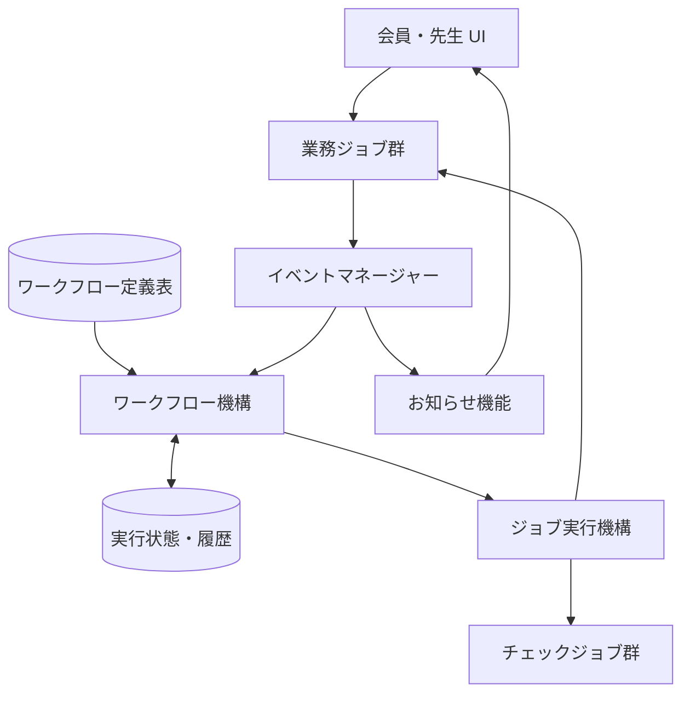

### 責務分離

| 構成要素       | 責務               |
| ---------- | ---------------- |
| ワークフロー機構   | 定義表に従った進行制御      |
| ジョブ実行機構    | 指定されたジョブの呼び出し    |
| 業務ジョブ      | 個別の業務処理          |
| チェックジョブ    | 進行条件と確定・暫定・待機の判定 |
| イベントマネージャー | イベントの受信・配送       |
| お知らせ機能     | 利用者への情報伝達        |
| 実行管理       | 現在位置・状態・履歴の保持    |

※コンポーネント間の具体的なAPI・通信方式は別途設計する。

---

## 3. ワークフロー基本構造

ワークフローは、業務ジョブとチェックジョブの組み合わせで構成する。

ワークフローの実行順序は、一覧表で定義する。

### 3.1 審査申請ワークフロー

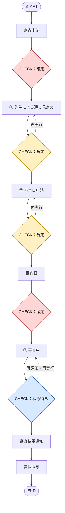

**凡例**

* 赤：確定チェック
* 黄：暫定チェック
* 青：状態待ちチェック
* 破線：戻り経路

この図は基本シーケンスを表す。戻り経路の実行条件は、チェックジョブの契約で定義する。

---

## 4. チェックジョブ

チェックジョブは3種類とする。

### 4.1 確定チェック

前工程の結果を確定する。

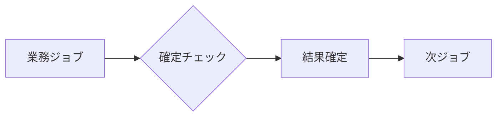

確定後、通常のワークフロー操作では前工程を再実行できない。

### 4.2 暫定チェック

前工程の結果を暫定として扱う。

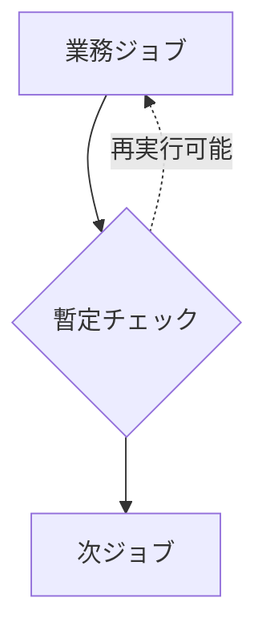

暫定状態では、次工程へ進んだ後でも前工程を再実行できる。

例：先生による見定め、審査日申請。

### 4.3 状態待ちチェック

所定の状態になるまで待機する。

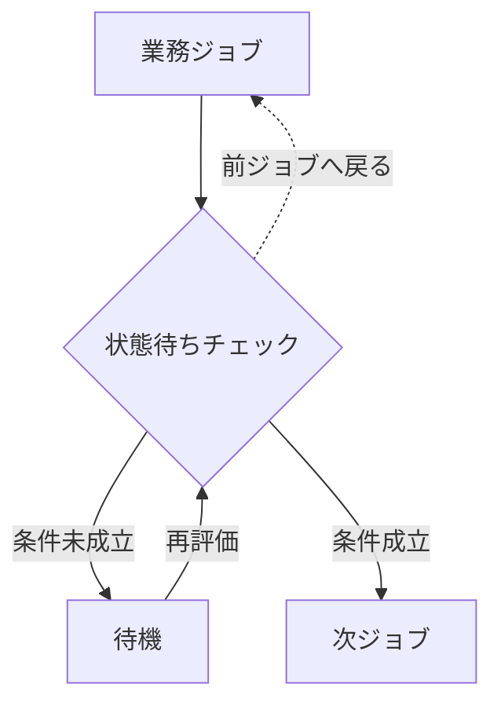

例：審査中から審査結果通知への移行。

状態待ち中に前ジョブを再実行する条件、およびイベントによる再評価方法は未決定とする。

---

## 5. ワークフロー定義表

ワークフローは、一覧表として定義できる構造とする。

### 5.1 定義例（通常進行・取り下げ分岐を統合）

| Step ID | 種別 | ジョブ・処理 | 次ステップ | 戻り先 |
|---|---|---|---|---|
| S001 | JOB | 審査申請 | S002 | — |
| S002 | CHECK_FINAL | 申請確定 | S003 | — |
| S003 | JOB | 先生による通し見定め | S004 | — |
| S004 | CHECK_PROVISIONAL | 暫定 | S005 | S003 |
| S005 | JOB | 審査日申請 | S006 | — |
| S006 | CHECK_PROVISIONAL | 暫定 | S007 | S005 |
| S007 | JOB | 審査日 | S008 | — |
| S008 | CHECK_FINAL | 確定 | S009 | — |
| S009 | JOB | 審査中 | S010 | — |
| S010 | CHECK_WAIT | 状態待ち | S011 | S009 |
| S011 | JOB | 審査結果通知 | S012 | — |
| S012 | JOB | 賞状授与 | S013 | — |
| S013 | END | 通常終了 | — | — |
| S101 | JOB | 本人による取り下げ要求 | S102 | — |
| S102 | JOB | 通常進行停止 | S103 | — |
| S103 | JOB | 返金対象・金額確認 | S104 | — |
| S104 | JOB | 全額返金処理 | S105 | — |
| S105 | CHECK_WAIT | 返金完了待ち | S106 | — |
| S106 | END | 取り下げ終了 | — | — |

Step IDは表の行順と独立する。S101の受付イベントと業務ジョブの重複実行を防ぐ実行契約は詳細設計で定める。

### 5.2 定義と実行の分離

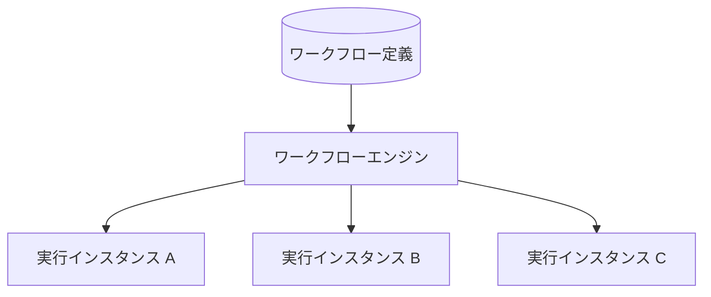

同じ定義から複数のワークフロー実行インスタンスを生成できる。

定義の変更が進行中のインスタンスに与える影響を制御するため、定義バージョンを管理する。

---

## 6. イベントマネージャー

イベントマネージャーは、業務処理などで発生したイベントを受け取り、必要な処理へ配送する。

イベントマネージャー自身は業務内容を判断しない。

### 6.1 イベント連携

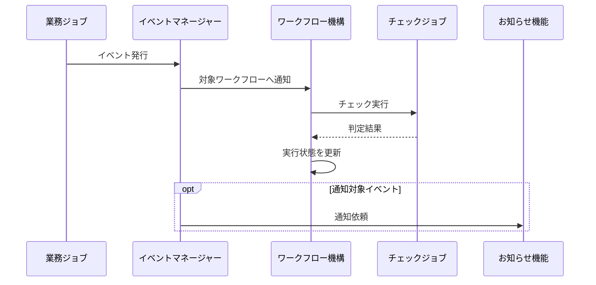

イベントと対象ワークフロー・通知処理との対応は、別途定義する。

---

## 7. お知らせ機能

お知らせ機能は、利用者への情報伝達を担当する。

業務処理そのものは実行しない。

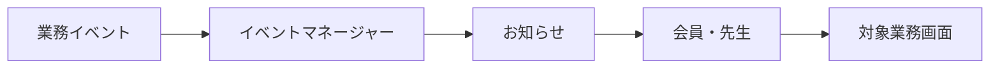

対象業務の例：

* 審査申請の受付
* 先生への審査申請通知
* 審査日程の連絡
* 審査日接近通知
* 審査結果通知
* 特別講習の案内
* 会費未払い通知

通知の閲覧と、申請・回答・結果管理は分離する。

---

## 8. 実行状態と履歴

ワークフロー定義と実行状態は別管理とする。

実行管理では、少なくとも次を識別できる必要がある。

* ワークフロー実行ID
* 使用する定義ID・バージョン
* 現在のステップ
* 実行状態
* ジョブの実行履歴
* チェック結果
* 再実行履歴

暫定チェックによる再実行では、過去の実行履歴を消去せず、実行の経緯を追跡できるようにする。

---

## 9. 将来のGUI編集

当初は一覧表によってワークフローを定義する。

将来的には、GUIによる編集を可能にする。

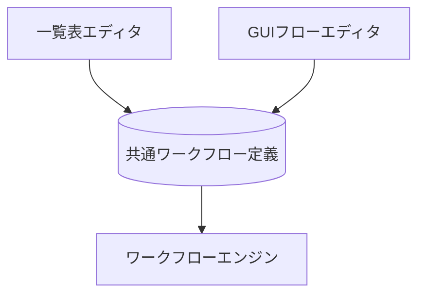

GUIと一覧表は、同じ定義構造を使用する。

ワークフローエンジンは、定義の作成方法を区別しない。

---

## 10. 既存アーキテクチャとの関係

既存の業務ディスパッチ、DAO/DTO、Firebase移行方針との整合性を維持する。

ワークフロー機構は、業務処理の実装方式やデータ保存方式を直接認識しない。

業務処理は既存の業務境界を通して実行する。

ワークフロー導入を理由として、業務別のAPIを大量に追加しない。

本設計は共通基盤の構想であり、既存業務を直ちに置き換えるものではない。

---

## 11. 未決定事項

以下は今後の詳細設計で決定する。

1. 各チェックジョブの具体的な入出力契約
2. 暫定ジョブ再実行時の後続ジョブの扱い
3. 状態待ちチェックの再評価・前ジョブ再実行条件
4. 確定済みジョブの例外的な訂正手続き
5. イベントの購読・配送・再送・重複防止
6. ワークフロー実行の排他制御
7. 定義バージョンの切り替え方法
8. ジョブ実行失敗時の復旧方法
9. お知らせの配信先・既読管理・通知経路
10. GUI編集機能の実装時期

---

## 12. 設計方針のまとめ

本アーキテクチャは、次の構成を基本とする。

**業務ジョブ：何をするか**

**チェックジョブ：確定・暫定・待機をどう扱うか**

**ワークフロー定義：どの順序で実行するか**

**ワークフロー機構：定義に従って実行を管理する**

**イベントマネージャー：発生したイベントを必要な処理へ伝える**

**お知らせ機能：利用者へ情報を伝える**

これらの責務を分離し、業務に依存しない共通基盤として構築する。

---

## 13. 審査申請の継続・再実行と本人取り下げ（追加設計）

本章は審査申請の具体的な業務ルールを補足する。基本設計の原則および第5章の定義表と併せて読む。

| 種別 | 基本規則 |
|---|---|
| CHECK_FINAL | 前工程の結果を確定し、通常の再実行を禁止 |
| CHECK_PROVISIONAL | 条件を満たせば次工程へ進行できるが、前工程の再実行を許容 |
| CHECK_WAIT | 条件成立まで待機し、イベント等で再評価 |

チェック**種別**と評価**結果**（例：PASS / WAIT / REJECT / ERROR）は分離する。結果の厳密な契約は詳細設計事項。

### 13.1 暫定再実行の原則

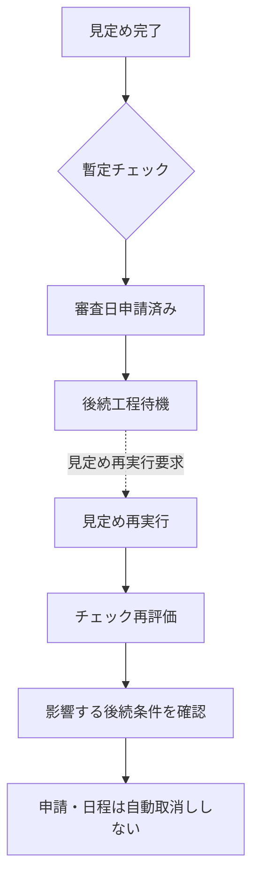

現在位置と各ステップの状態は別管理。後続工程の有効性が失われた場合の保留・再評価は別途規定する。

### 13.2 本人取り下げ・全額返金

#### 確定した業務ルール

- 審査申請は本人が取り下げない限り継続する。
- 転勤・ケガ・病気・家庭の事情など、取り下げ理由により返金額を変えない。
- 本人取り下げ時の審査料は**全額返金**する。
- 取り下げ理由の詳細な収集は必須としない。

#### 提案する制御規則（未確定）

- 取り下げ要求の受付時点で通常の審査進行を停止する。
- 返金が完了するまで、取り下げ処理全体は完了としない。
- 返金ジョブの再実行では、既存返金記録を照合して二重返金を防ぐ。
- 取り下げ可能な工程範囲、審査結果確定後の扱い、未入金時の扱いは未決定。

#### 通常進行と取り下げ分岐の全体図

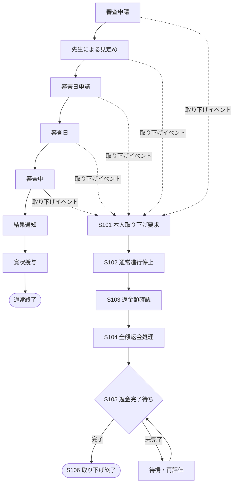

図中の取り下げ可能範囲は仮置き。返金未完了時に返金ジョブを無条件に再実行するものではない。

#### 取り下げ時のイベント連携

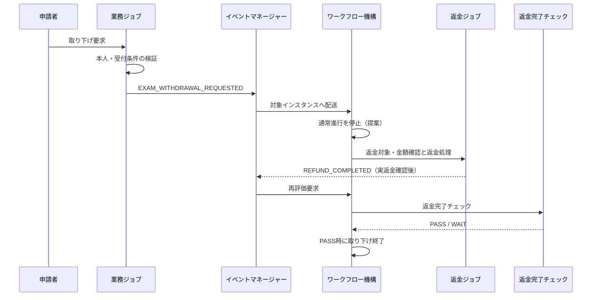

### 13.3 イベント分岐定義表

| Event ID | イベント | 対象 | 遷移・動作 | 条件 |
|---|---|---|---|---|
| E001 | EXAM_WITHDRAWAL_REQUESTED | 審査申請インスタンス | S101分岐を要求 | 本人・有効申請・取り下げ可能範囲の検証 |
| E002 | REFUND_COMPLETED | S105待機中のインスタンス | S105を再評価 | 対応する返金処理の完了を確認 |

イベント配送は業務条件の成立を保証しない。遷移可否は業務境界／チェックジョブで確認する。

### 13.4 補足する実行管理原則

- ワークフローの現在位置と、各ステップの状態・履歴を分離する。
- 暫定工程を再実行しても、成立済みの申請や日程を自動取消ししない。後続工程への影響は再評価する。
- 人間の操作待ちもJOBとして表現できるが、JOBは必ずしも即時実行プログラムを意味しない。
- チェック種別（FINAL / PROVISIONAL / WAIT）と判定結果（PASS / WAIT / REJECT / ERROR の例）を分離する。厳密な契約は未決定。
- 取り下げ要求と返金完了を区別し、返金の二重実行を防ぐ。

### 13.5 追加の未決定事項

- 取り下げ可能な工程範囲、審査結果確定後・未入金時の扱い。
- 返金手段と実返金完了の証跡。
- 取り下げ受付とS101ジョブの冪等性、同時実行時の排他。
- 既に開始された自動ジョブの停止方法。
- 暫定再実行に伴う後続チェックの再評価範囲。

※本章の「提案する制御規則」は確定済みの業務ルールと区別し、詳細設計で検証する。

---

## 追加設計：CTicket 案件管理（2026-11-04 / Prototype v0.2）

### 目的・境界

チケットは「誰が、何を、いつまでに処理するか」を表す案件管理の器。CWorkflowは工程実行ツールであり、CTicketを継承せず、チケットに依存しない。チケットはワークフローを紐づけなくても成立する。「ワークフローは業務を知らない」の原則を維持する。

### データモデル

`CTicketManager` がチケットを作成・編集・状態遷移し、`ITicketRepository` が保存する。初期アダプターは `CMemoryTicketRepository`。

| 項目 | 意味 |
|---|---|
| ticketId | 案件識別子。実行IDとは別 |
| title / description | 件名・説明 |
| createdBy / createdAt | 起案者・起案日時（原則不変） |
| ownerId | 案件全体の責任者。工程別承認者とは別 |
| dueAt | 案件完了期限。期限監視は後続課題 |
| status | DRAFT / OPEN / IN_PROGRESS / COMPLETED / CANCELLED |
| workflowId / workflowVersion / executionId | 任意のワークフロー関連付け |
| parentTicketId | 親チケット参照。親子連動制御は未実装 |
| updatedAt | 最終更新日時 |

### 状態遷移（初期実装）

- `DRAFT → OPEN`：提出
- `OPEN → IN_PROGRESS`：ワークフロー実行IDを紐づけて開始
- `OPEN / IN_PROGRESS → COMPLETED`：完了（プロトタイプでは実行完了に追随）
- `DRAFT / OPEN / IN_PROGRESS → CANCELLED`：取消（ただし実行中ワークフローの安全な中断は未実装。GUIでは実行中の取消を公開しない）
- `DRAFT / OPEN / IN_PROGRESS`：件名・説明・責任者・期限を編集可能

### 画面・試作の対象

ローカルGUIにチケット発行、一覧、件名編集、提出、実行開始、取消を追加。既存の工程図・実行履歴を維持する。試作の実行開始は単一のデモ定義に接続する。

### 制約と後続課題

- **永続化なし**：Nodeプロセス再起動でチケットと実行状態は消える。Firestore連携は未着手。
- **認証・認可なし**：createdBy/ownerIdは入力値。実運用で信頼できるログイン主体に置換する。
- **排他制御なし**：同時リクエスト・多重起動対策、冪等性、監査ログは本格運用前に必要。
- **承認・期限監視・カレンダー・工程編集**：本変更では実装しない。
- **取消と実行停止**：実運用では原子的に整合させる必要がある。
- **工程別担当者・承認者**：チケット全体のownerIdと区別し、後続の割当機構に実装する。
- **定義バージョン**：チケットへ識別子を保持するが、定義の不変化と実行時固定は後続課題。

### テスト

既存ワークフロー試験6件にチケット試験7件を追加。ローカルで TypeScriptビルドと13件のテスト成功を確認。
