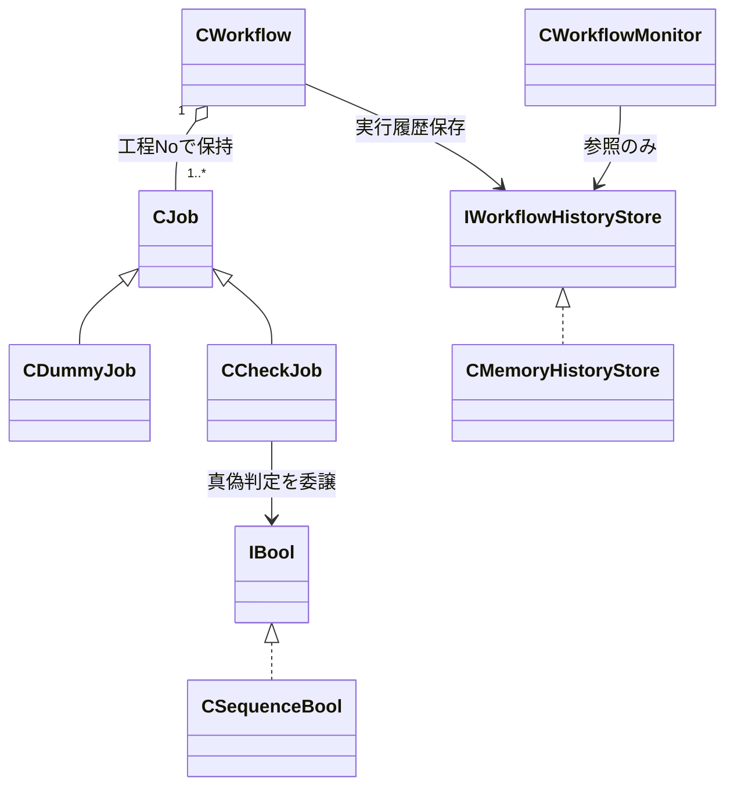

# ARCH-026 仮ジョブ実行プロトタイプ（2026-11-04）

## 目的
既存スケルトン `src/core/` を上書きせず、今回合意した **CWorkflow / CJob / CCheckJob / IBool / 工程No / 工程モニター** を動く形で検証する。

## 実行
Node.js と TypeScript (`tsc`) が必要。`npm run demo`、`npm test`。追加npm依存なし（TypeScriptコンパイラは環境に必要）。

## 設計上の確定部分
- CWorkflow はジョブの集合と工程Noによる実行制御を担当し、CJobを継承しない。
- CCheckJob は IBool を引数で受け、true なら流し先、false なら戻り先の工程Noを返す。
- CWorkflowMonitor は履歴ストアの読み取り専用ビュー。履歴は上書きせず蓄積する。

## デモ
工程10 仮ジョブA → 工程20 チェック（false→10を2回、true→30） → 工程30 仮ジョブB → 工程40 仮ジョブC → END。

## 意図的な未実装
- 永続DB、並列実行・排他、停止/再開、イベント、返金、認証、確定/暫定/待機チェックの業務規則。
- `LIMIT_REACHED` はテスト用の安全停止。運用時の待機・障害復旧を意味しない。
- 本プロトタイプは既存 `src/core` の契約と未統合。既存リポジトリへの適用パッチではない。
- 運用向け工程モニター画面は未実装。読み取り専用API相当の集計機能のみ。

## 次工程
ARCH-026統合版にクラス図・状態図を反映し、旧スケルトンとの整合を取り、保存と再開の契約を設計する。

## クラス構造（試作）

