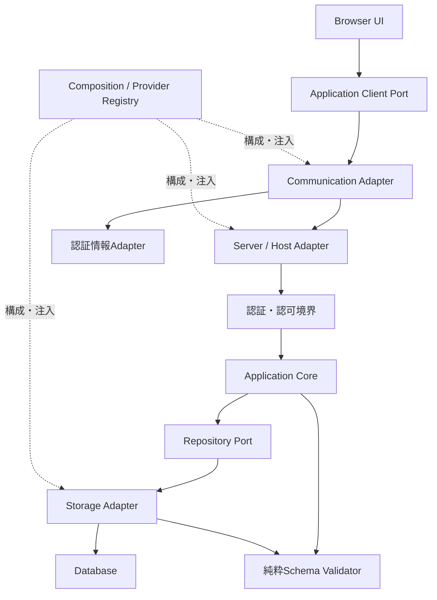

# Phase 5B: 汎用基盤の最小契約案

- 日付: 2026-11-05（JST）
- 状態: レビュー対象の設計提案。承認済み仕様・実装ではない。
- 判断基準: [ADR-001](../adr/ADR-001-platform-architecture-principles.md)
- 計画: [最小契約設計計画](../plans/PHASE-5B-minimal-contract-design.md)

## 1. 前提と適用範囲

中心原則は「依存層を差し替えるだけで、アプリケーションCoreを変更せずに、異なるDB・実行環境へ移行できること」。DBだけでなくブラウザ・通信・認証・Host・Build・Deployを対象とする。

本書の型、名称、配置、構成、エラー、受入条件はすべてレビュー対象の提案であり、実装を強制する確定仕様ではない。今回変更するのは本書のみ。既存コード・テスト・設定・Schema、既存システムを変更せず、Build・Deploy・Migration・Commit・Pushを実施しない。

最小範囲は単一SchemaのRead / Write / Add。検索、削除API、採番、複数レコードトランザクション、汎用DIコンテナ、動的プラグインロードは含めない。Schema自体の削除はMigrationの設計対象であり、レコード削除APIとは別である。CJob・Workflowは独立オプションとし、HelloWorldに依存させない。

## 2. アーキテクチャと責務



矢印は呼出し・利用の流れ。ソースコードの依存はAdapterから共通契約へ向ける。Coreは具体Adapter、環境設定、SDK、HTTP、ファイルパス、環境変数をimportしない。

| 要素 | 責務 | 担当しないこと |
| --- | --- | --- |
| Application Core | 論理操作、業務検証、Repository呼出し | DB選択、通信、認証トークン解釈 |
| Repository Port | 論理レコードの取得・条件付き更新・新規追加 | HTTP、UI、採番、Migration実行 |
| Storage Adapter | 原子的な存在／Revision条件、物理変換、保存、結果変換 | 業務上の認可・操作再送 |
| Application Client Port | ブラウザから利用するアプリ操作の型 | DBの場所・物理構造 |
| Communication Adapter | wire形式、認証情報付与、通信失敗の正規化 | 直接DB操作、業務判断 |
| Host Adapter | wire入力検証、認証・認可の適用、Core呼出し、応答変換 | 業務データの別実装 |
| Provider | 対応契約・Capabilityの宣言とAdapter生成 | アプリ操作そのもの |
| Composition | 論理定義と環境設定の照合、秘密参照解決、初期化・終了 | Coreへの環境情報の漏出 |

## 3. Repository Port案

```typescript
interface HelloRecord { id: string; message: string }
type Revision = string; // 保存先非依存の不透明トークン
interface Stored<T> { record: T; revision: Revision }
interface Repository<T extends { id: string }> {
  read(id: string): Promise<Stored<T> | null>;
  add(record: T): Promise<Stored<T>>;
  write(record: T, expectedRevision: Revision): Promise<Stored<T>>;
}
```

Repositoryは初期化時に単一Schemaと対象versionへ束縛する。各操作へcollection名やSchema Versionを渡さない。IDは呼出し側が用意し、初期候補では`[A-Za-z0-9][A-Za-z0-9_-]{0,63}`とする。自動trim・正規化・採番は行わない。

| 操作 | 成功 | 失敗と変更禁止条件 |
| --- | --- | --- |
| Read | 最新の確定済みレコードとRevision。未存在はnull | 不正ID、保存先障害、不正な保存済みデータ |
| Add | 新しいRevision付きレコード | 同一IDがあればALREADY_EXISTS。内容が同じでも成功に置換しない |
| Write | 更新後の新しいRevision付きレコード | 未存在はNOT_FOUND。期待Revision不一致はCONFLICT。暗黙upsert禁止 |

Writeは部分patchではなく、Schemaに適合するレコード全体の置換とする。ID変更は不可。更新対象IDはrecord.idで決まり、別IDへ移動する操作は含めない。同一内容のWriteでも新しいRevisionを発行する。Revisionを数値として加算・比較したり、DBの更新日時として解釈したりしない。

Addの存在確認＋作成、Writeの存在確認＋Revision比較＋更新はそれぞれ原子的に行う。単なるRead→無条件Writeでは不適合。同じRevisionからの並行Writeは一件だけ成功し、並行Addも一件だけ成功する。単一Repository操作の原子性だけを必須とし、複数操作のトランザクションは要求しない。

戻り値は保存確定後に返す。入力・戻り値の参照変更で保存データを変更できない。例外で返した失敗が保存済みか不明な場合は、確定失敗として偽装せずOUTCOME_UNKNOWNとする。成功後の逐次Readは更新を観測する。全呼出し間の一貫性はAdapterの対応範囲内で保証し、その範囲を宣言する。

### エラー分類

```typescript
type FailureCode =
  | 'INVALID_ARGUMENT' | 'VALIDATION_FAILED'
  | 'NOT_FOUND' | 'ALREADY_EXISTS' | 'CONFLICT'
  | 'UNAUTHENTICATED' | 'FORBIDDEN'
  | 'UNAVAILABLE' | 'OUTCOME_UNKNOWN'
  | 'SCHEMA_MISMATCH' | 'DATA_CORRUPT'
  | 'UNSUPPORTED_CONFIGURATION' | 'INTERNAL';
interface Failure {
  code: FailureCode;
  issues?: ReadonlyArray<{ path: string; rule: string }>;
}
```

RepositoryのPromiseは失敗時にcodeを持つ例外でrejectする案。認証・認可エラーはHost側の分類であり、通常Repositoryは返さない。ブラウザへのwire境界では後述のResultへ変換する。SDK例外、秘密値、パス、rawレコード、内部stackは公開結果に含めない。

無効な引数・Schema違反はI/O前に拒否する。その後、対象なし、Revision不一致の順で判定する。不正な保存済み構造はDATA_CORRUPT、開いた保存領域のversion不一致はSCHEMA_MISMATCH。接続不可が送信前に判明した場合はUNAVAILABLE、変更の成否を判定できない場合はOUTCOME_UNKNOWN。INTERNALは予期しない障害であり成功扱いにしない。

### 操作結果の確実性

操作結果は次の3状態として整理する。これは既存の成功値・エラー分類の意味を補足するもので、新たなAPIや結果型を追加するものではない。

| 状態 | 判定根拠 | 扱い |
| --- | --- | --- |
| 確定成功 | 操作完了を示す有効な結果を受領した。書込では保存確定が条件 | 成功値を返す |
| 確定失敗 | 操作要求を送信していないことが確定、または実行側から当該操作による変更なしと確定した拒否結果を受領した | VALIDATION_FAILED、ALREADY_EXISTS、CONFLICT等の該当エラー。送信前の接続不可はUNAVAILABLE |
| 成否不明 | 送信後の応答喪失、送信したか判断できない障害等により、実行結果を確定できない | 書込はOUTCOME_UNKNOWN。未保存・変更なしとは断定しない |

「送信前」は、実行側へ要求を渡していないことを確認できる場合に限る。送信処理が例外になっただけでは未送信の証明にならない。送信後でも有効な確定拒否応答があれば確定失敗だが、timeout・接続断・不正応答だけからは判定しない。Repository内部でも、保存処理へ渡した後の成否不明を同様に扱う。予期しない障害という理由だけでINTERNALを返し、書込の成否不明を隠さない。

Readは保存変更を伴わないため、取得結果を得られない通信障害をUNAVAILABLEとして再試行できる。書込後のReadは現在の状態照合であり、元の操作成功の証明とは限らない。同内容が他の操作で保存された可能性、Read後の競合、元の要求がまだ処理中である可能性があるため、一致・不一致・未存在のいずれからも元の操作結果を自動確定しない。

### 検証責任

Coreは外部入力をunknownとして構造検証し、将来の業務検証を担当する。Storage Adapterも同じ純粋Validatorを利用して書込境界を検証し、読取結果の適合性を確認する。検証ロジックを二重実装しない。TypeScript型だけで実行時入力を信頼しない。物理データと論理レコード間の変換はAdapterに閉じる。

## 4. Schema・Version・Migration境界

```typescript
type LogicalType = 'string' | 'number' | 'boolean';
interface SchemaDefinition {
  id: string;
  version: string; // 初期は完全一致。大小や互換性を推論しない
  idField: 'id';
  fields: Readonly<Record<string, {
    type: LogicalType; required: boolean;
  }>>;
  additionalProperties: false;
}
```

HelloWorldの候補はSchema ID `hello-record`、version `1`、idとmessageを必須stringとする。messageは空文字を許容する。ID規則は前節を適用する。初期型にnull、配列、ネスト、Date、undefined、NaN、Infinity、暗黙変換、default適用は含めない。追加型は契約versionとAdapter対応能力を確認して導入する。Schema IDとversionが同じ定義の内容変更は拒否し、内容fingerprintの保存方式は実装前に決める。

Revisionはレコード内容にもSchema Versionにも含めず、保存メタデータとして管理する。Local fileは保存領域にSchema識別とversionを持つ。メタデータのない既存領域を暗黙に現行versionとみなさない。Adapterは論理Schemaの物理投影を所有し、Coreはシート名・collection・ファイル構造を知らない。

| 差分 | 互換性の評価案 | Migrationの責務 |
| --- | --- | --- |
| entity追加 | 既存entityとは独立。ただし構成・能力照合が必要 | 新保存領域の準備 |
| 任意field追加 | 新readerが旧データを読めても、厳格な旧readerは新fieldを拒否し得る | 読書き両方向の互換性を判定 |
| 必須field追加・型変更・ID変更 | 初期は非互換扱い | 変換・値補完・ID競合・事後検証 |
| field削除・entity削除 | 非互換・データ損失の可能性 | 影響確認、廃止手順、明示的適用 |
| 物理名・配置変更 | 論理Coreには影響させない | Adapterの物理移行 |

互換性をversion文字列だけで決めない。reader/writerと既存データの組合せで判定する。

MigrationはRepositoryとは別の管理経路とする。Schema管理側がfrom/to・差分・変換要求を計画し、保存先側のMigration処理が排他・適用・履歴・事後検証を担当する。業務変換が必要ならアプリ提供の純粋変換を計画から参照する。通常のread/write/addから自動Migrationしない。

初回は「新しい空領域の初期化」と「version不一致時の起動拒否」までを候補とする。将来のplan/apply、再開、適用履歴、バックアップ・復旧は管理側へ追加し、Repository操作は維持する。Migration中は当該領域の利用を止める方式を初期候補とし、オンライン移行、旧新同時稼働、全DB共通rollbackは保証しない。

## 5. Application Definitionと環境構成

```typescript
interface CapabilityRequirement {
  slot: string; name: string; version: number;
  mode: 'required' | 'optional';
}
interface ApplicationDefinition {
  id: string;
  contractVersion: string;
  schemas: ReadonlyArray<{ id: string; version: string }>;
  coreModules: ReadonlyArray<{ id: string; version: string }>;
  requires: ReadonlyArray<CapabilityRequirement>;
}
interface EnvironmentBinding {
  applicationId: string;
  bindings: Readonly<Record<string, {
    provider: string;
    options: Readonly<Record<string, unknown>>;
    secretRefs?: Readonly<Record<string, string>>;
  }>>;
}
```

合成例：Application Definitionには`id: hello-world`、Schema `hello-record@1`、Core module `hello-core@1`を記録し、workflowは含めない。Repository slotの要求には非同期Read / Write / Add、原子的create、Revision条件付き更新を挙げる。Bはclient / host slotの契約も要求する。

EnvironmentBindingだけでstorageをmemory、local-file、firestore-emulator等へ選択する。ファイル配置、endpoint、Host設定、認証方式はこの環境側に置く。Application Definitionを環境ごとに書き換えない。schema projectionも依存層の構成に置く。

secretRefsは秘密値ではなく論理参照名。Compositionの秘密解決処理がサーバー側で解決して対象Adapterだけへ渡す。ブラウザの構成やbundleへ秘密値・秘密ストア参照を出さない。ブラウザ公開設定は許可した項目だけを別途投影する。CoreにはEnvironmentBindingや秘密解決機構を注入しない。

## 6. Provider / Adapter / Capability

```typescript
interface CapabilityOffer { name: string; version: number }
interface AdapterHandle<P> {
  port: P;
  close(): Promise<void>;
}
interface Provider<P> {
  id: string;
  portContract: string;
  offers: ReadonlyArray<CapabilityOffer>;
  open(context: {
    schema?: SchemaDefinition;
    options: Readonly<Record<string, unknown>>;
    secrets: Readonly<Record<string, string>>;
  }): Promise<AdapterHandle<P>>;
}
```

登録はComposition内の静的なID→Provider表で十分とする。port型ごとに登録先を分け、任意文字列からコードをロードしない。Providerはfactory、Adapterはopenで生成される実行時実体であり、RepositoryやHost等のPortを提供する。

照合順序：論理定義とSchema参照検証→provider存在・Port契約確認→options検証→slot単位のCapability照合→秘密解決→open→実接続・version確認→起動完了。途中失敗時は生成済みAdapterを逆順closeし、利用開始しない。closeは複数回呼べ、処理中の操作は停止受付後に完了させて資源を解放する案。終了失敗は診断として報告する。

Capability名は例として`repository.atomic-create`、`repository.revision-write`、`storage.restart-persistence`を使い、versionは初期は完全一致照合。Hostの能力でstorage slotの不足を埋めない。必須不足はUNSUPPORTED_CONFIGURATIONで起動前に拒否。任意不足は構成結果へ明示し、Coreの必須動作を変えない。特化機能を使うモジュールは必要な能力を必須として宣言する。任意能力のためだけの新Portは利用例が出るまで追加しない。

### Capabilityの宣言・照合・実証

| 区分 | 確認すること | 保証しないこと |
| --- | --- | --- |
| 宣言 | Providerが提供するとする能力・version・対応範囲を示す | 宣言された動作が正しく実装されていること |
| 起動時照合 | 要求と宣言がslot・version・必須／任意の条件で一致すること。実接続等の初期化確認は別途行う | 原子的Add、CAS、永続性等が実行時にも成立すること |
| 実装の契約テスト | 共通契約テストとAdapter固有検証で、宣言に対応する動作を確認する | 未検証のOS・ファイルシステム・runtime・障害条件での正しさ |

Capability照合に成功しても実装の正しさは保証されない。atomic-createはA10、revision-writeはA9、restart-persistenceはA7等の既存受入シナリオで実証し、テストした環境と保証範囲を記録する。宣言と検証結果が一致しないAdapterは、その能力を要求する構成に適合したものとして扱わない。照合は契約テストの代替ではない。

Memoryはrestart-persistenceを提供しない。Aの共通操作テストと永続化拡張テストを区分し、Memoryの永続化テスト省略を合格に数えない。

Local fileは初期に「一領域を単一Hostプロセスが所有」と宣言する。起動時に排他的所有権を取得し、第二所有者は拒否。同一プロセス内の条件確認と書込を直列化し、データとRevisionを一括保存する。所有権取得・一括置換が保証できないファイルシステムは非対応とする。原子的置換だけを複数プロセスの競合制御とみなさない。ロック残存・強制終了・電源断の保証は別途検証し、初回の永続性は正常終了後再起動を最低条件とする。

### Local fileの保証範囲と初回検証

| 区分 | 保証・検証の範囲 | 初回の位置づけ |
| --- | --- | --- |
| 同一プロセス内の競合制御 | 条件確認と保存を直列化し、並行WriteのRevision競合と並行Addの重複を検出 | 必須。A9・A10で確認 |
| 複数プロセスの同時所有防止 | 同一領域への所有権取得を排他的にし、第二所有者を拒否 | 必須。A12で確認。複数writerの共同利用を保証する意味ではない |
| 正常終了後の再起動時の永続性 | 保存成功後に正常closeし、別プロセスで内容とRevisionを再取得 | 必須。A7で確認。Memoryには要求しない |
| 異常終了・電源断後の復旧 | 書込途中、一時ファイル、flush前後、ロック残存、破損等からの回復 | 調査・追加検証が必要。初回A7の合格を復旧保証に拡張しない |

初回は上の必須範囲と、既存A12の異version・破損データの明示的拒否を検証する。異常終了後にデータを復旧できること、最後の成功応答まで電源断後も保持すること、自動修復できることは保証しない。対象OS・ファイルシステムごとの所有権取得、一括置換、flushの性質を調べ、保証できない構成を非対応とする。

ロックが残り所有者の生存を確認できない場合、初回の安全側の扱いは取得を拒否し、暗黙に削除・奪取しないこととする。残存判定の方式、PID再利用等を考慮した所有者識別、解除できる条件・担当、解除前のデータ確認、手動復旧手順は未決定。単なる経過時間やファイルの存在だけで安全な解除を判断しない。これらは複数プロセスの同時所有防止とは別の復旧課題として追加調査する。

## 7. Browser Communication契約

```typescript
interface HelloApplicationPort {
  read(id: string): Promise<Stored<HelloRecord> | null>;
  add(record: HelloRecord): Promise<Stored<HelloRecord>>;
  write(record: HelloRecord, expectedRevision: Revision): Promise<Stored<HelloRecord>>;
}
// Core側の入口とブラウザ側clientで同じ操作型を利用する。
// 通信の成功結果・失敗を対応づけるwire案：
type Result<T> = { ok: true; value: T } | { ok: false; error: Failure };
type HelloRequest =
  | { operation: 'read'; id: string }
  | { operation: 'add'; record: HelloRecord }
  | { operation: 'write'; record: HelloRecord; expectedRevision: Revision };
interface CredentialSource {
  getCredential(refresh: boolean): Promise<string | null>;
}
```

CoreとClientは同じ論理操作型を共有し、同一クラスの継承や同一実体にはしない。HelloWorldが単純なのでRepositoryと入口の操作が似ているが、汎用RPCクラスや二つ目のDB abstractionは追加しない。通信側は業務入口を呼び、Repositoryをブラウザへ公開しない。

最初のwire候補は同一endpointへのJSON POST、3種のoperationとResult。Hostはunknown入力を検証し、成功・未存在Readを200、入力不正を400、未認証を401、権限不足を403、NOT_FOUNDを404、重複／競合を409、利用不可を503へ対応させる案。ステータスだけで判断せずResultを検証する。不正応答はINTERNALまたは成否不明に分類し、raw本文を公開しない。Revisionはwireでも不透明stringのまま。

通信Adapterがfetch等を所有し、CredentialSourceは必要な場合だけ構成から注入する。Firebase SDK・google.script.run・DOM・Browser StorageをCoreから参照しない。Hostが資格を検証してprincipalを作り、論理操作・対象の認可を実施してからCoreを呼ぶ。UIの許可判定やclient送信principalは信頼しない。認証失敗の応答は業務実行前に生成する。認証と認可は別責務とする。

### 通信失敗・再送・重複Add

- Readは通信失敗後に明示再試行可能。無限の自動再試行はしない。
- 初回はAdd / Writeの通信Adapterによる自動再送を禁止する。401後の自動トークン更新＋書込再送も初回対象外。
- 書込要求の送信後、または送信有無不明のタイムアウト・応答喪失はOUTCOME_UNKNOWN。利用者には「未保存」と断定せず、再認証・再接続後にReadで状態照合する。照合だけで元の操作成功を証明したとは扱わない。
- Addは同じユーザー操作の間、同じIDと入力を維持する。二重クリックを抑止し、再試行で別IDを生成しない。同時二重送信でもStorageの原子的Addが一件だけ作る。
- 再Readで同内容が見つかっても「今回の要求が成功した」とは断定しない。同内容は照合結果として表示する。再AddはALREADY_EXISTSとして返す。
- Writeの再実行は同じexpectedRevisionを維持する。既に成功していればCONFLICTとなり、無条件上書きはしない。更新を見直す場合はReadから別の操作として開始する。
- exactly-onceや成功応答の再現は保証しない。将来必要ならoperation ID、要求fingerprint、結果台帳とデータ変更の原子的保存を、通信／アプリ境界の能力として追加検討する。RepositoryのAddをupsertへ変更して代替しない。

初回UIはpending状態をメモリ保持し、未解決操作がある間は新Addを開始させない。再読み込み時に操作文脈が失われる制約を表示する。Browser Storageを使った回復を追加するならUI側Adapterへ隔離し、資格・秘密値を保存しない。汎用Storage Portは初回には作らない。

## 8. HelloWorld-A/Bの具体的検証計画

### HelloWorld-A

同一Core、Schema、共通契約テストをMemory / Local fileへ適用する。fixtureはid `sample-1`、message `hello`等の合成データのみ。各テストは独立領域を使う。

| ID | 手順 | 期待結果 |
| --- | --- | --- |
| A1 | Add→Read | 内容・IDが一致しRevisionが取得できる |
| A2 | Readで得たRevisionでWrite→Read | 更新内容と新Revision。旧Revisionは再利用不可 |
| A3 | 未存在Read | null |
| A4 | 未存在Write | NOT_FOUND、追加されない |
| A5 | 同一IDを再Add | ALREADY_EXISTS、元データを維持 |
| A6 | message欠落・異型・余分なfield・不正ID | 適切な入力／検証エラー、変更なし |
| A7 | Local fileでプロセスP1が保存・正常終了、P2が再open→Read | 内容・Revisionを維持。Memoryには要求しない |
| A8 | Adapterを交換して同じCoreとテストを実行 | Core・Schema・共通テストのコード差分なし |
| A9 | 同じRevisionから並行Write | 一件成功、一件CONFLICT、成功した値だけが残る |
| A10 | 並行Add | 一件成功、一件ALREADY_EXISTS |
| A11 | 返却値を変更、別途Read | 保存値は変わらない |
| A12 | Local fileに第二所有者／異version／破損データ | 起動拒否または明示エラー。暗黙修復・Migrationなし |

共通テストは初期化・破棄するfixture factoryだけを交換する。永続化・ロック検証はAdapter拡張テストとして分離し、外部DB接続が必要な検証をunit testへ混ぜない。

### HelloWorld-B

推奨する二つの比較構成（未実装・未検証）：

| 要素 | B1 | B2 |
| --- | --- | --- |
| Browser | 同じUI・client操作 | 同じUI・client操作 |
| 通信 | JSON HTTP Adapter | 同じJSON HTTP Adapter、endpoint構成のみ変更 |
| Host | Node HTTP Host | Fetch Request / Response型のHost Adapter（ローカル検証可能なruntime） |
| Core・Schema | 同一 | 同一 |
| Storage | Local file | Firestore Emulator用Adapter |
| 起動・梱包 | ローカルNode構成 | 別Host起動構成＋ローカルEmulator |

B2はHost契約も交換し、DBだけの比較にしない。Fetch型runtimeの具体製品とFirestore接続方法は実装前に承認対象とする。GASやCloud Runへの実Deployは初回B成立条件に含めない。この二構成で未検証の本番Host・全ブラウザ・全DBまで移植性を一般化しない。

初回Bの認証はループバック限定・合成データ専用の匿名開発構成とする案。両Hostは同じ「開発限定操作を許可する」ポリシーを構成で受け、公開接続を拒否する。別途Fake Credential／Verifierで未認証・権限不足を検証する。実IdP、Cookie、CSRF、CORS、公開Hostの認証適合は後続条件であり、初回B成功だけでは保証しない。

同じブラウザE2EシナリオでA1〜A6、A9〜A10相当を実行する。B1でHost再起動後Read、B2でHost再起動後にEmulatorへ再Readする。Emulator自体の再起動永続性はこの試験と別とする。並行二画面で競合、二重クリック、送信後応答喪失、サーバー未到達、不正Result、認証拒否を追加し、OUTCOME_UNKNOWNの表示と自動再送なしを確認する。障害注入はテスト用Adapter／proxyで行う。

### 交換時の変更許可範囲（将来の配置候補）

変更可能：`composition/`、`bindings/`、`adapters/`、`providers/`、Host起動・Build・Deploy定義、依存パッケージ・lock、Adapter固有fixture。これらは候補の配置であり今回は作成しない。

変更禁止：HelloWorld Core、論理Schema・Application Definition、共有契約・Validator、UIの論理操作、共通契約テスト・E2Eシナリオ。endpoint等は依存層から注入する。依存をまとめ直すBuildは許容するが、環境別にCoreソースを書換生成しない。同一revisionのCore等についてソースhash・差分と両構成の試験結果を保存し、環境変更に伴う契約変更を「Adapter交換」と数えない。

## 9. 既存ARCHコードとの対応と差

| 現在のファイル・契約 | 確認した事実 | 本案との関係 |
| --- | --- | --- |
| `src/ports/contracts.ts`: DefinitionRepository | version指定の非同期get | 定義参照の先例。HelloRecord Repositoryと統合しない |
| 同: InstanceRepository | saveにexpectedRevision、取得結果にRevisionなし | CASの意図を尊重。本案はReadにもRevisionを返す。既存契約の修正・統合は別レビュー |
| `src/core/engine.ts`: WorkflowEngine | 実行遷移は骨格 | 本案で完成扱いにしない |
| `src/prototype/ticket.ts`: ITicketRepository | 同期get/list/save、未存在undefined | 本案の非同期・null・add/write分離と非互換。自動置換しない |
| `src/prototype/workflow.ts`: IWorkflowHistoryStore | save/load、同期またはPromise、CASなし | 履歴の用途を維持。汎用Repositoryへ無条件変換しない |
| 同: CJob / CCheckJob | Promise<void>とboolean分岐 | 独立オプションの既存検証契約。今回は統合しない |
| `gui/workflow-runtime.js`: WorkflowRuntime | handler結果とCHECK待機、メモリ状態 | HelloWorldの依存にしない。WAITの意味は今回確定しない |
| `gui/exam-jobs.js`: CExamBusinessJob | fields検証とMap保持 | 構造／業務検証分離の参考。業務fieldは抽出しない |
| `gui/workflow-definitions.js`: DefinitionStore | JSON保存とrename | ファイル処理の参考。CASや複数所有者制御を保証する根拠にはしない |
| `src/adapters/README.md` | 業務APIの重複を避ける方針 | HelloWorldだけに必要なPortを提案し、既存業務APIを複製しない |

前回確認した既存資産も参照した。`shared/DAO_Business.js`のreadById/updateByKey/upsertByKeyは本案と同義ではなく、Revisionや原子的Addを提供する契約へそのまま代入できない。`cloud/member-read/DAO_Core_Firestore.cjs`にはupdateTime前提条件があるが、共通DAO経由の公開契約は異なる。`shared/Schema_Renderer_Firestore.js`は純粋変換、`web/qr/dojo_api_client.js`は通信注入の参考である。ただし後者の401再送を本案の書込へ無条件適用しない。これらのソースを本書へコピーせず、抽出や変更は別途判断する。

## 10. 代替案と採否理由

| 論点 | 候補 | 推奨・理由 |
| --- | --- | --- |
| 競合 | 無条件上書き / optional Revision / 必須Revision | 必須Revision。競合を見えなくする抜け道を初回から作らない |
| Revision表現 | レコードにversion / 不透明メタデータ | メタデータ。Schema Versionと分離し、DB固有値を解釈させない |
| Write | patch / 全体置換 / upsert | 全体置換。最小Schemaで差分merge規則を増やさず、未存在は失敗 |
| 書込再送 | 自動再送 / 結果台帳 / 自動再送なし | 初回は再送なし＋Read照合。exactly-once台帳は必要性確認後 |
| API失敗 | すべてResult / 例外＋wire Result | Core内Promise reject、wire Result。既存非同期Portに近く、HTTP例外を漏らさない |
| Capability | 無制約の文字列フラグ / version付き静的照合 | slotとversionの静的照合。動的marketplace等は不要 |
| Local file排他 | renameのみ / 単一所有者＋直列化 / 汎用分散lock | 単一所有者。初回から分散基盤を作らず保証範囲を明示 |
| B比較 | Node＋DB交換のみ / HostとDB交換 / GAS即時移植 | HostとDB交換。DBだけで達成とせず、GAS移植固有の負荷は延期 |
| 既存契約 | 一括置換 / 新規万能Repository / 最小HelloWorld契約 | 最小契約。Workflow/Ticketの意味を失わせない |

## 11. 未決定事項・リスク

- 本案自体の採否、正式名称・配置・配布単位、型とwireのversion規則。
- Local fileの所有権ロック・古いlockの回復・flush・OS差・強制終了／電源断時の保証。原子的条件を満たせない方式は採用しない。
- ロック残存時の所有者識別・生存確認、解除条件と担当、解除前確認・手動復旧手順は未決定。初回は不明なロックを暗黙解除しない。
- Revision生成、Schema fingerprint、保存形式、実SDKでのCAS・createの実現方式。推測で動作保証しない。
- Fetch型Hostの具体runtimeと対応DB driver。未対応の組合せを実装前に確認する。
- 初期ID規則・型制限・空message許容が標準例として適切か。大きなpayload上限と通信timeoutの具体値。
- OUTCOME_UNKNOWNの回復UI、リロード後のpending保持、必要になった場合の操作台帳・保存期間・原子性。
- 実IdPと公開環境の認証・認可、ブラウザの資格保存、CORS/CSRFの具体方式。
- Migrationの履歴・再開・復旧、互換性判定器、データ削除時の承認・保全方式。初回の起動拒否だけで全要件達成としない。
- 統一CLI・アプリ生成・Coreモジュール管理の完全な契約は別設計。最小HelloWorld契約への接続点を維持する。
- CJob・Workflow・Ticketの既存未決定事項、既存資産の公開・再配布可否は今回承認しない。

## 12. 実装工程への移行条件

1. 本案のRepository意味・必須Revision・エラー・Schema制限・再送方針をレビューし承認する。
2. 初回AのLocal file保証範囲、Bの二構成・runtime・認証範囲、変更許可範囲を決める。
3. A1〜A12とBの共通・固有テストを実装時の受入条件として合意する。
4. 実装対象・延期事項、公開可能な依存と合成データ、作成・変更するファイル範囲を明示する。
5. 別途実装の指示を受ける。本書作成のみを実装・Build・Deploy・Migration実行の承認とはしない。

設計案の提示時点で停止し、レビューと承認を待つ。
