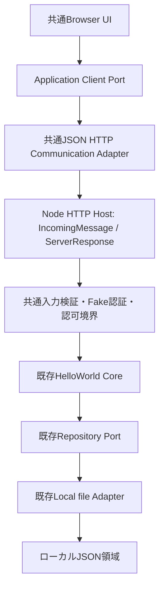
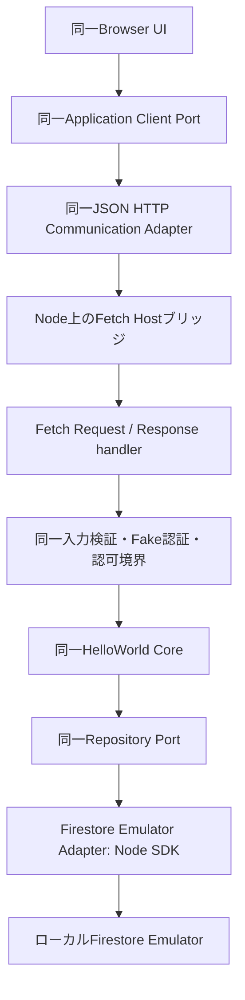

# Phase 5B: HelloWorld-B実装前設計・工程計画

- 日付: 2026-11-06（JST）
- 状態: レビュー対象の提案。実装・Build・Emulator起動・E2Eは未実施。
- 上位判断: [ADR-001](../adr/ADR-001-platform-architecture-principles.md)
- 関連: [最小契約計画](PHASE-5B-minimal-contract-design.md)、[最小契約設計](../design/PHASE-5B-minimal-contracts.md)、[HelloWorld-A](../HELLOWORLD_A.md)

## 1. 目的と確認範囲

依存層だけを交換し、Application Coreを変更せずにブラウザからDBまでのRead / Add / Revision付きWriteを成立させる。今回は本書だけを作成し、既存コード、テスト、設定、HelloWorld-A、既存業務システムを変更しない。Commit・Push・Build・Deployを行わない。

既存の`src/hello/`、両Storage Adapter、Composition、共通契約テスト・故障注入テスト、packageとTypeScript設定を確認した。現行RepositoryはPromise、未存在Readはnull、Addはcreate-only、Writeは期待Revision必須の全体置換。これを弱めず利用する。

ルートの`tsconfig.json`は存在せず、`tsconfig.prototype.json`でCommonJSをdistへ生成する。現在のpackageにはTypeScriptがあり、B用の通信・Host・Firestore・ブラウザテスト依存はない。Aの手引きにある26件という件数は初期記録であり、後続の監査修正テストを除外する理由にしない。

### 成立性の証拠レベル

| 区分 | 今回確認したこと |
| --- | --- |
| ローカル実機・読み取り | Node 24.16.0、Java 21、グローバルfirebase-tools 15.22.3の存在。Request / Response / fetchの存在 |
| 未導入 | ARCH内の`@google-cloud/firestore`、`firebase-admin`、`@hono/node-server`、`@playwright/test`、ローカルfirebase-tools |
| 公式資料 | Node Hostブリッジ、Node Firestore SDK、Emulator接続、transaction、Emulator起動停止の契約 |
| 未検証 | SDKインストール後のNode 24での実動作、Emulatorの取得・起動、通信疎通、WindowsでのB1/B2 E2E |

「資料上成立する推奨候補」と「接続実証済み」を区別する。設計中にSDK導入や検証コードを作らず、実機接続は工程6の開始ゲートで確認する。

## 2. 推奨構成と構成図

### B1



### B2



**B2推奨: Node.js 24 + `@hono/node-server` + 純粋なFetch handler + `@google-cloud/firestore` + Firebase CLIのFirestore Emulator。** Honoアプリフレームワーク自体は必須にせず、ブリッジのfetch callbackへhandlerを渡す案とする。Host handlerの入口は`(request: Request) => Promise<Response>`で、Nodeストリーム変換はブリッジに閉じ込める。公式Node AdapterにはFetch形式の入口があり、global Request / Responseの置換は無効化できる。[Node Server公式](https://github.com/honojs/node-server)

B1もB2も実runtimeはNodeである。二つのHost API契約とStorageの交換を検証できるが、NodeからWorkers等へのruntime移植が実証されたとは報告しない。異runtime比較を初回の必須条件とする場合は、この提案を承認する前に再選定する。

## 3. Runtime候補比較

| 候補 | Emulator接続・SDK | 追加負担 | 判定 |
| --- | --- | --- | --- |
| Node 24 + Fetchブリッジ | Node SDKの実行環境と同じ。既存CommonJS Coreを直接利用可能 | 小さなHostブリッジ依存、Fetch入口実装 | 推奨。資料上の接続経路が明確で、現在のWindows環境を利用可能 |
| Workers互換runtime / workerd | Fetch入口は適合。Node SDKの依存API・gRPCとEmulator接続は未確認 | Wrangler等、互換フラグ、場合によりREST transaction実装 | 初回採用を見送る。Fetch対応だけでSDK適合と判断しない |
| Deno等の別runtime | npm互換機能があっても、このSDKとEmulatorの組合せは今回未検証 | runtime導入、CommonJSとSDK依存の追加検証 | 後続候補。現時点でWindows上の成立を保証しない |

WorkersのNode互換には部分対応や呼出し時に失敗するshimがあり、Node APIのimport成功だけでは十分でない。WorkersでSDKが絶対に動かないと断定せず、本調査では成立性未確認とする。[Workers Node互換](https://developers.cloudflare.com/workers/runtime-apis/nodejs/)

推奨B2は、Node上のFetch HostとNode向けDB SDKを同じプロセスに配置するため、Workers内のgRPCや別プロセスのDB proxyを前提にしない。公式SDKのFirestore clientとtransaction APIを利用する設計である。[Firestore Node client](https://cloud.google.com/nodejs/docs/reference/firestore/latest/firestore/firestore)

## 4. 既存資産の再利用・新規実装範囲

| 資産 | 方針 |
| --- | --- |
| `src/hello/contracts.ts` | 無変更でRepository / Stored / Revision / HelloRecord / RepositoryErrorを利用 |
| `src/hello/core.ts` | 両構成で同一HelloWorldを生成。環境名分岐を追加しない |
| `src/hello/schema.ts` | 同一Schema / Validator。Host・Storageもこれを利用し、検証をコピーしない |
| `src/adapters/hello/local-file.cjs` | B1で無変更利用。close、残存lock拒否、成否不明・cleanup診断を維持 |
| `src/adapters/hello/memory.cjs` | 通信・Hostの単体fixtureに利用。Bの永続化合格に代用しない |
| `src/composition/hello.cjs` | Aの既存入口を維持。Bは別のcompositionで既存Adapterを組み立てる |
| `tests/hello/contract.cjs` | Firestore fixtureにも同じ共通テストを適用。複製しない |
| `tests/hello/hello.test.cjs` | Aの回帰として維持。B固有E2E・SDK故障注入は別配置 |
| 既存GUI / Workflow / Ticket / CJob | 無変更。Bから参照しない |

新規候補はclient契約・Result検証、HTTP通信、Host共通dispatch、Node Host、Fetch Host、開発用認証認可、Firestore Storage、B Composition、共通UI、E2E fixture・fault proxy、起動停止runner。既存契約を置換する汎用RPCやDIコンテナは作らない。

配置候補は`src/hello-client/`、`src/adapters/hello-http/`、`src/adapters/hello/firestore-emulator.cjs`、`src/composition/hello-b.cjs`、`web/hello/`、`tests/hello-b/`。確定ファイル一覧は実装開始時に提示する。SDKや秘密情報をブラウザbundleへ含めない。

Browser用は新しい入口だけを対象にesbuildでbundleする案。既存Schema / Validatorの同じソースを利用し、CommonJS出力をブラウザへ直接読み込ませない。既存tsconfigの出力方式は変えず、B用の型検査設定を分離する。Node依存がbundleへ入らないことを検査する。

## 5. Browser Communication契約

以下は提案であり、今回実装しない。既存の型はtype-only importで再利用する。

```typescript
interface HelloApplicationClient {
  read(id: string): Promise<Stored<HelloRecord> | null>;
  add(record: HelloRecord): Promise<Stored<HelloRecord>>;
  write(record: HelloRecord, expectedRevision: Revision): Promise<Stored<HelloRecord>>;
}
type FailureCode =
  | 'INVALID_ARGUMENT' | 'VALIDATION_FAILED'
  | 'NOT_FOUND' | 'ALREADY_EXISTS' | 'CONFLICT'
  | 'UNAUTHENTICATED' | 'FORBIDDEN'
  | 'UNAVAILABLE' | 'OUTCOME_UNKNOWN'
  | 'SCHEMA_MISMATCH' | 'DATA_CORRUPT'
  | 'UNSUPPORTED_CONFIGURATION' | 'INTERNAL';
type Result<T> = { ok: true; value: T } |
  { ok: false; error: { code: FailureCode; issues?: { path: string; rule: string }[] } };
interface CredentialSource {
  getCredential(refresh: boolean): Promise<string | null>;
}
type HelloRequest =
  | { operation: 'read'; id: string }
  | { operation: 'add'; record: HelloRecord }
  | { operation: 'write'; record: HelloRecord; expectedRevision: Revision };
```

UIはClientだけを呼ぶ。HTTP Adapterがfetch、endpoint、timeout、資格付与、Result検証を所有する。Repository・ファイル・FirestoreをBrowserへ公開しない。UIでの入力補助とHostの検証を区別し、HostはBrowserの検証済みという主張を信用しない。

wireは`POST /api/hello`、`Content-Type: application/json`、上記HelloRequest。成功は`{ok:true,value:...}`、未存在Readは`value:null`。エラーは`{ok:false,error:{code:...}}`。初回は一要求につき一操作のみ。成功結果のrecordも既存Validator、revisionは非空stringで検証する。Read以外でnullを成功として受け入れない。

工程1監査反映：Add成功は要求recordとの一致、Write成功は要求id・messageとの一致およびexpectedRevisionからの更新を検証する。Revisionは不透明な非空文字列として等値比較だけを行う。不一致・未更新はOUTCOME_UNKNOWNとし、自動再送しない。Readは要求idと結果idの一致を維持する。

HTTP状態・Result形・既知codeを照合し、矛盾した応答を有効な拒否と見なさない。raw本文、RepositoryError全体、stack、cleanup詳細、SDK例外はwireへserializeせず、codeと許可されたissuesだけを生成する。

| 結果・code | HTTP候補 |
| --- | --- |
| 成功、Readのnull | 200 |
| INVALID_ARGUMENT / VALIDATION_FAILED | 400 |
| UNAUTHENTICATED / FORBIDDEN | 401 / 403 |
| NOT_FOUND | 404 |
| ALREADY_EXISTS / CONFLICT | 409 |
| UNAVAILABLE / OUTCOME_UNKNOWN | 503（本文codeで区別） |
| DATA_CORRUPT / SCHEMA_MISMATCH / INTERNAL | 500 |
| UNSUPPORTED_CONFIGURATION | 原則listen前に起動拒否。稼働中に検出した場合は500で停止判断 |

不正JSONは400、非対応methodは405、媒体型不一致は415、body上限超過は413とし、本文はINVALID_ARGUMENTを使う。最大64KiB、応答待機30秒を初期候補とする。64KiBは通信制約であり、論理Schemaへmessage長制限を追加しない。上限超過でCoreを実行しない。

応答本文にも独立して64KiB上限を設ける。Communication AdapterはContent-Lengthを信用せず、ストリームから実受信byte数を計測し、超過時は読み取りを中断する。UTF-8 byte数で判定し、64KiBちょうどは許可。超過・不正UTF-8はReadではINTERNAL、Add/WriteではOUTCOME_UNKNOWN。timeout・AbortControllerを維持し、cancel等の停止処理の失敗で元のエラーを隠さない。要求上限いっぱいのrecordを含む応答がenvelope差で超過する場合も、応答側上限で拒否する。

### 結果の確実性と再送

- 呼出し前の検証失敗、fetchを呼ぶ前に判明する接続構成不正等は確定失敗。
- 有効な成功Resultは確定成功。有効なALREADY_EXISTS等は確定拒否。
- 書込をfetchへ渡した後、または渡したか不明な障害、timeout、応答喪失、不正ResultはOUTCOME_UNKNOWN。fetchのrejectだけから未送信とは推論しない。サーバー未到達をproxyが知っていてもclientから証明できなければ同様に扱う。
- Read通信失敗はUNAVAILABLE、不正ResultはINTERNALとして表示し、明示再試行可。Readは保存変更を伴わない。
- 書込の自動再送、401後の資格更新＋書込再送、成功不明時の別ID Addは禁止。初回のHTTP Adapterはreadも自動再送せず、全操作一回の送信とする。
- 状態照合Readは操作成功の証明ではない。一致／未存在から成功・失敗を自動確定しない。pending ID・入力・expectedRevisionをメモリ保持し、未解決中は新Addを抑止する。リロードでpendingを失う制約を表示する。

## 6. Host・認証認可・ライフサイクル

### 共通処理とHost固有処理

Host固有は受信body・headers・URL・接続情報の取得と応答書込。共通dispatchはunknown要求の検証、資格検証、操作単位の認可、Core呼出し、Result生成を担当する。処理順はmethod/path/媒体型/body上限→認証→要求の構造検証→操作・対象認可→Core。Core側でも既存Validatorを利用する。

B1はNode HTTPのストリームをbyte上限付きで読み、B2はRequest.bodyを上限付きで読む。Content-Lengthだけを信頼しない。Fetchのrequest.json()だけで無制限にbufferしない。クライアント切断後も保存が完了し得るので、abortをrollbackと解釈しない。

両Hostは同じ静的UI・client bundle・許可済み公開設定をsame-originで配信する。任意パスのファイル配信はしない。APIは同一originのみとし、listenを127.0.0.1に限定、HostとOriginを起動時originへ照合、CORSのワイルドカードを使わずCookie認証を導入しない。Originなしは非Browserテスト用に明示構成した場合だけ許可。loopbackだけを認証の代替や公開運用の安全保証とはしない。

### 開発用認証・認可

既定は明示的な匿名開発モードで、同じ合成操作を許可するpolicyを両構成へ注入。E2Eは同じFake CredentialSourceとVerifierのテストモードへ切替可能にする。資格は公開可能なfixtureラベルであり、実ユーザー・秘密tokenではない。

テストモードでは資格なし／不正は401、有効だがread専用principalのAdd/Writeは403、有効なwriterは許可する。principalはHostで生成し、client送信principalを信用しない。Verifierと認可policyは別の関数としてdispatchへ注入し、SDK・実IdP・資格永続保存は導入しない。未認証／認可拒否時にCore・Repository呼出し件数ゼロも確認する。

### 起動・停止

Compositionは設定・Capability照合→Storage open→Core一個生成→共通dispatchへCoreとpolicy注入→Host listen→ready通知の順とする。B1は既存openLocalFile、B2は新Firestore Adapterを選ぶ。HelloWorld Coreへ渡すのは既存Repositoryのみ。

停止は新規受付停止→受理済み操作のdrain→Storage close→プロセス終了。B1はcloseでlockを解放。B2は保留transactionを待ってSDK terminateを呼ぶ。終了timeoutを超えた強制停止は別診断とし、書込不明を成功へ変えない。起動途中で失敗したら初期化済み資源を逆順終了し、先行エラーをcleanupで上書きしない。WindowsのE2Eはsignal名だけに依存せず、runnerと子Host間のIPC停止要求と終了確認を使う。

## 7. Firestore Emulator Storage Adapter設計

### 接続方式と依存

Node向け`@google-cloud/firestore`を推奨し、firebase-adminは初回不要とする。SDKの実行環境はB2のNodeプロセスであり、BrowserへSDKを入れない。Node SDKは`FIRESTORE_EMULATOR_HOST`でEmulatorへ接続できる。[Firestore Emulator公式接続手順](https://cloud.google.com/firestore/native/docs/emulator)

環境構成の値をCompositionで検証し、SDK生成前にEmulator hostを設定する。`127.0.0.1:<port>`のみ、projectは合成`demo-arch026-hello`、databaseは`(default)`に限定する。protocol付きhost、外部host、値欠落、実project、既存の値との不一致は起動拒否し、本番へfallbackしない。資格ファイル・ADCを要求する動作があれば工程6で停止して原因を確認する。

本構成専用の子プロセスに設定を閉じ、テスト間のprocess.env変更競合を避ける。Emulator / SDK / CLIのprojectを一致させる。demo projectは実資源を持たない方式として公式に案内されている。[Firebase Emulator接続・demo project](https://firebase.google.com/docs/emulator-suite/connect_firestore)

### 保存表現・Schema確認

試験ごとに独立namespaceを与え、その配下のmetadata文書へSchema ID `hello-record`、version `1`、既存定義と同じJSON.stringify方式のSHA-256 fingerprintを保存する。レコード文書IDは論理ID。文書内容は`{record:{id,message},revision:string}`とし、既存Storedの形へ変換する。文書IDとrecord.idの不一致、欠損・型不正はDATA_CORRUPT。

namespaceのopen時にmetadataを確認し、異version・fingerprint不一致はSCHEMA_MISMATCH。metadata欠落かつレコードありはDATA_CORRUPT。空namespaceのみ初期化を許可し、同時openに備えてtransactionでmetadata生成・空確認を行う。Adapter経由の書込は必ずmetadataを検査し、管理外writerがある構成は保証外。Migration・自動修復は行わない。metadata形式不正と意味上のversion不一致を区別し、A12相当を固定codeで試験する。

### Add / Write / Revision

RevisionはAdapterが生成するUUID文字列とし、Firestore TimestampをCoreへ露出しない。同内容Writeも新Revisionになる。

- Read: metadata検査と対象読取を一貫した読取で行い、未存在はnull。保存値を既存Validatorで検証し複製する。
- Add: transactionでmetadata・対象を読み、既存ならALREADY_EXISTS、なければtransaction.createで作成。存在確認と追加を原子的に行う。
- Write: transactionでmetadata・対象を読み、未存在はNOT_FOUND、保存Revisionと期待Revision不一致はCONFLICT、一致した場合だけ全体置換。read→transaction外setは禁止。
- UUID候補は一操作で生成し、再実行callbackで外部副作用を起こさない。transaction終了のPromise成功後だけStoredを返す。

SDKには既存文書を拒否するcreateがあり、transactionにもcreate/get/setがある。[DocumentReference.create](https://cloud.google.com/nodejs/docs/reference/firestore/latest/firestore/documentreference)、[Transaction](https://cloud.google.com/nodejs/docs/reference/firestore/latest/firestore/transaction)

Node SDKのtransactionは競合時にcallbackを再実行する場合がある。これはBrowser操作再送とは区別するが、同じexpectedRevisionを保ち、callback中にログ配送・通知・外部I/Oを行わない。再試行後に旧Revisionを読めばCONFLICTで終える。[runTransaction](https://cloud.google.com/nodejs/docs/reference/firestore/latest/firestore/firestore)

transaction開始前の確定障害はUNAVAILABLE。SDKが確定拒否を返す場合は該当codeへ正規化する。commit送信後のtimeout・接続断など、反映の有無を判断できない場合はOUTCOME_UNKNOWN。SDKのUNAVAILABLEを無条件に確定失敗へ変換しない。SDKの再試行・commit応答喪失時の振る舞いは故障注入で検証し、判定できない経路は保守的に成否不明へ分類する。

並行Add／Writeは別client/Host経由でも検証し、単一プロセスのPromiseキューでDB競合を隠さない。closeは受付停止・実行中操作完了後にSDK接続を終了する。[terminate](https://cloud.google.com/nodejs/docs/reference/firestore/latest/firestore/firestore)

### 永続性の意味

B2で必須なのは「Hostを再起動しても、稼働を続けるEmulatorから再Readできること」。Emulator自体の再起動後の保持・電源断耐性とは区別する。`storage.restart-persistence`のversion 1はAのプロセス再起動シナリオの範囲で要求し、構成結果には「Host再起動まで、Emulator継続稼働」という保証範囲を明記する。この能力をEmulator再起動にも適用するかは未決定であり、暗黙に同一視しない。

## 8. CapabilityとEnvironmentBinding

Application Definitionは環境共通で`hello-world`、Schema `hello-record@1`、Core module `hello-core@1`。slotごとの必須要求を以下の候補とする。名称は既存能力以外はレビュー対象。

| slot | 必須Capability（すべてversion 1案） |
| --- | --- |
| storage | repository.atomic-create、repository.revision-write、storage.restart-persistence |
| communication | communication.json-http、communication.no-auto-write-retry |
| host | host.json-http、host.authn-boundary、host.authz-boundary、host.loopback-only |

Fetch入口はB2のHost Provider特性であり、共通アプリの必須条件にしない。B1へFetch能力を要求しない。HTTPの内容・エラー契約は同じものを要求する。

EnvironmentBindingの合成例：B1はhost=`node-http`、storage=`local-file`、directory=`runtime-data/hello-b1`。B2はhost=`node-fetch`、storage=`firestore-emulator`、Emulator host=`127.0.0.1:8080`、project=`demo-arch026-hello`。両者のcommunication=`json-http`、endpoint=`/api/hello`。UIはsame-originの相対endpointを公開構成から受け、環境名を参照しない。

B用Compositionにslot別静的Provider表を置き、既存Aの表を変更しない。論理参照→Provider/Port/options→slot単位の必須能力→初期化・実接続→listenの順で検査。不足ならUNSUPPORTED_CONFIGURATION、listenもデータ操作も開始しない。要求を満たすためにApplication Definitionを環境別に弱めない。

宣言・起動照合・契約テストは別であり、宣言一致だけでCASや永続性を保証しない。Storageは既存共通テスト＋固有テスト、通信・Hostは共通E2Eと単体試験で実証する。未提供能力は起動失敗にする構成試験も加える。

## 9. 起動・停止・Windows再現計画

将来追加する依存候補：実行時`@hono/node-server`、`@google-cloud/firestore`。開発用`firebase-tools`、`@playwright/test`、`esbuild`、`@types/node`。TypeScriptは既存を利用。ブラウザSDK・Auth SDK・Hono本体は必須にしない。実装開始時に各packageの対応Node/Windows・依存versionを確認し、lockfileで固定する。

現行マシンにはNode 24、Java 21、CLIがあるが、グローバルCLIを再現性の前提にしない。プロジェクトローカルのCLIとブラウザbinaryを使う。PlaywrightのWindows要件とブラウザ導入手順は公式資料に従い、OS edition等の実条件は工程開始時に確認する。[Playwright導入](https://playwright.dev/docs/intro)

コマンド名は今後作成する候補であり、現時点では実行不可：

| 入口候補 | 責務 |
| --- | --- |
| `hello:b1` | A成果物とBrowser bundle確認、B1をloopback起動 |
| `hello:b2` | Emulator設定検証、B2起動。Emulatorを暗黙に本番へ置換しない |
| `test:hello:b1` | B1一時領域・Host・Browser・fault proxyの起動と終了 |
| `test:hello:b2` | Emulator wrapper内で同じsuiteをB2 fixtureへ適用 |
| `test:hello:b` | 両fixtureを順に実行し、差分・hash・結果を収集 |

Emulator起動候補は`firebase emulators:exec --only firestore --project demo-arch026-hello --config <B専用設定> "node <B2テストrunner>"`。これは将来手順例で、今回は実行しない。CLIはrunner終了後にEmulatorを終了できる。export/importはEmulator再起動検証を追加する場合だけ別工程にする。[Emulator CLI](https://firebase.google.com/docs/emulator-suite/install_and_configure)

runnerはshell依存の`VAR=value command`を使わず、Node spawnのenvへ値を渡す。Windowsの.cmd起動は引数を固定・検証する専用経路を使う。Host ready通知、ポート競合、timeout、子プロセス終了を確認し、既存サービスを勝手にkillしない。Emulatorは専用port・合成namespaceに隔離し、全DB消去の管理APIを共通fixtureで使わない。初回Emulator JAR・Browser binary取得にはネットワークが必要な可能性がある。

## 10. 共通E2Eテスト計画

同一UI bundle、同一client、同一suiteをPlaywright projects/fixtureでB1/B2に適用する。fixtureだけがHost・Storage・ready・停止・再起動・fault proxyを提供する。環境別にテスト本文を複製しない。[Playwrightパラメータ化](https://playwright.dev/docs/test-parameterize)

UIはID/message入力、Add/Read/Write、取得Revision、code、pending状態、状態照合結果を表示する。RevisionをUIが解釈しない。DOMへmessageをHTML挿入しない。通常UIは二重クリック抑止、並行試験は二画面／二clientで同じID・旧Revisionを使う。

| ケース | 実際にassertする内容 |
| --- | --- |
| Add→Read | 入力した期待record、戻り値、Read値の一致 |
| Read→Write→Read | 期待message、ID維持、新Revision、旧Revision拒否 |
| 未存在Read / Write | null表示 / NOT_FOUND、Writeで追加されない |
| 重複Add | ALREADY_EXISTS、元record・Revision維持 |
| Schema不正 | 型・必須・余分なfield・ID不正の拒否、変更なし。UI補助を迂回したwire入力も検証 |
| Revision競合 | 旧RevisionでCONFLICT、勝者以外の値で上書きされない |
| 並行Add | 同時に開始した二clientで成功一件・ALREADY_EXISTS一件 |
| 並行Write | 同じRevisionで開始し成功一件・CONFLICT一件。逐次awaitにしない |
| Host再起動 | 停止・再open後に同じrecord・RevisionをRead。B2はEmulatorを停止しない |
| 未認証 / 権限不足 | 401 / 403、正しいcode、Core実行ゼロ、保存変化なし |
| サーバー未到達 | ReadはUNAVAILABLE。書込をfetchへ渡した後ならOUTCOME_UNKNOWN。自動再送ゼロ |
| 応答喪失 | proxyが上流の保存成功応答を受けてからBrowser側接続を切断。UIはOUTCOME_UNKNOWN、DBには一件、再Readは状態照合表示 |
| 不正Result | 不正JSON・成功値の異型・未知code・HTTP矛盾を注入。書込は成否不明として扱い成功表示しない |
| pending表示 | 未解決中は新Add抑止、同じID・入力を保持。リロード時制約も表示 |
| 書込自動再送なし | proxyの上流到達数とHost論理呼出し数が一件。401・timeout・応答喪失で二回目なし |

故障注入はテスト用proxy/通信依存注入で行い、製品endpointに故障操作を追加しない。HTTP操作数とSDK transaction callback試行数を別に計測する。SDK内部再試行をBrowser二重送信と誤判定しない。transport timeoutは試験fixtureで短縮し、共通の期待動作は維持する。

認証等の一部はHTTP/dispatch単体テストでCore spyを用い、ブラウザE2Eでは表示・実保存結果も確認する。B2のStorage単体は既存Repository共通suite、Schema異常、commit応答喪失、SDK terminate失敗を追加する。cleanup失敗で元のcodeを隠さないことも回帰条件。

## 11. 実装工程・成果物・受入条件

| 工程 | 成果物 | 依存 | 受入条件 |
| --- | --- | --- | --- |
| 1 Communication契約 | 型、wire validator、HTTP client、Fake CredentialSource | 既存Aの型・Validator | 3操作とResultの型・失敗分類、再送なし、未知応答拒否の単体PASS |
| 2 Node Host（B1） | Node受信、共通dispatch、開発policy、B用Composition | 1、Local file | 受信上限・認証認可・Core注入・listen前検査・正常drain/closeのHTTP試験PASS |
| 3 共通UI | HTML、client接続、bundle、pending/Revision/code表示 | 1 | 環境名分岐・SDK依存なし。安全な表示、入力・状態照合が操作可能 |
| 4 B1 E2E | 共通suiteとB1 fixture、fault proxy | 2、3 | 第10節全ケースをLocal fileでPASS、A回帰PASS |
| 5 Fetch Host | 純粋Request/Response handlerとNodeブリッジ | 1、共通dispatch | Nodeストリーム非依存のhandler単体、B1と同じHTTP契約をPASS。Storage fixture利用可 |
| 6 Emulator Storage | SDK Adapter、CLI設定、起動停止runner、B2 binding | 既存Repository、5で選ぶNode環境 | 最初に実SDK疎通・create・transaction CAS・資格不要を実証。その後共通契約・Schema確認・障害分類PASS |
| 7 B2 E2E | B2 fixture、共通suiteのproject設定 | 3、5、6 | 第10節全ケースを同じsuiteでPASS。Host再起動をEmulator再起動と区別 |
| 8 無変更検証 | hash一覧、依存検査、Build対応記録、比較報告 | 4、7 | Core・Schema・Repository契約・共通E2Eソース同一。クリーンBuildと実行成果物の対応、両構成の成功を提示 |

工程6の資料上の経路が実機で成立しなければB2は未成立として停止・報告する。CoreやRepositoryを弱めて通さない。依存version・Firestore SDK経路の変更はレビュー対象。各工程の範囲を確認し、小さく検証してから次へ進む。

変更許可候補は新規client/Host/Storage/Composition/UI/fixture、B専用設定、Build入口、package/lockのみ。既存A Core・論理Schema・Repository契約・共通テスト、Workflow・Ticket・CJob・GUIは変更禁止。A共通suiteはfactory指定だけでFirestoreへ適用する。共有ソースの前後hashだけでなく、同じソースからのクリーンBuildと実際に読み込む成果物の一致も確認する。

## 12. リスク・未決定事項・実装開始条件

| 論点 | 対策・残る判断 |
| --- | --- |
| B1/B2が同じNode runtime | Host契約＋DB交換の到達点と明記。異runtime実証は後続か、初回要件の再選定かを承認する |
| 実SDK / Windows接続は未検証 | 工程6冒頭で実疎通。依存導入・JAR取得・port利用を実装工程で許可範囲に含める |
| 既存A Compositionは単一storage専用 | B専用の小さな構成入口を追加し、A表・Coreを変更しない。汎用DIは作らない |
| SDK再試行と成否不明 | 操作とcallbackを区別。commit応答喪失を実証し、未知の失敗を確定拒否へ変換しない |
| Schema metadataの同時初期化 | transactionと専用namespaceで検証。管理外writer、オンラインMigrationは対象外 |
| 永続性の能力範囲 | Host再起動とEmulator再起動を区別。後者まで要求するならexport/import試験を別途合意 |
| 匿名開発・Fake資格 | loopback＋same-origin制約と明示設定。公開運用、実IdP、Cookie/CSRF認証設計を保証しない |
| Browser pending消失 | 初回はメモリ保持・制約表示。自動再送や結果台帳、Browser Storage回復は追加しない |
| Build境界 | client bundleへNode/SDK依存を混入させず、環境ごとのCoreソース変換を禁止 |
| A手引きの件数・既存JOB FAIL | 過去記録を最新結果と混同しない。別件exam-jobs FAILはBの変更へ混ぜない |

実装前に、推奨B2と到達点、依存package・runtime固定、能力の永続性範囲、匿名/Fake認証方式、HTTP上限・timeout、作成変更ファイル、工程6のローカル起動許可をレビューする。現在の実装・設定は一切変更しない。

本書の作成は実装・Build・Emulator起動・Deployの承認ではない。文書提示後は停止し、レビューと次の指示を待つ。
